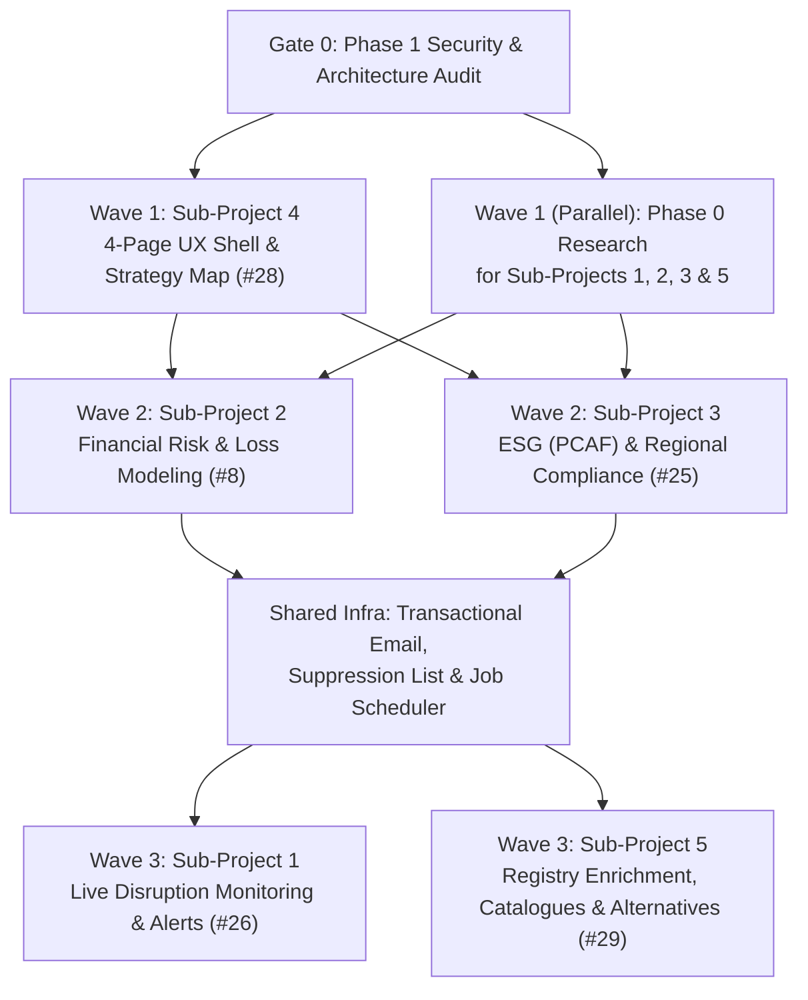

# Kulgo Product & Engineering Roadmap

This document is the single source of truth for Kulgo's completed Phase 1 foundation and sequenced Phase 2 roadmap. Every Phase 2 sub-project has a detailed specification in [`docs/specs/`](./specs/) and a tracking GitHub Issue.

---

## Phase 1 — Core Platform Foundation (Completed ✅)

| Milestone | Scope | Status |
| :--- | :--- | :--- |
| **M1** | Auth (Argon2id + HttpOnly sessions), ArcadeDB graph/geospatial schema, Workspace CRUD, MapLibre + Deck.gl map | ✅ Merged |
| **M2** | Pure `@kulgo/engine` (HHI, SPOF, transport & Scope 1/2/3 ESG), Logical Graph (`React Flow`), What-If Simulator | ✅ Merged |
| **M3** | Partner Invitations, server-side anonymized Tier-2+ traversal (`PRIVACY_CONTRACT.md`), Opt-In Alternative Directory | ✅ Merged |
| **M4** | Org ESG Settings, Bulk CSV/JSON Import-Export, CSRD Executive Report, Docker packaging, live ArcadeDB CI | ✅ Merged |
| **M5** | Production hardening (secret validation, rate limits, body limits, JSON logging), Org Team RBAC (`OWNER`/`MEMBER`), Docker CI | ✅ Merged |
| **M6** | Org-scoped Compliance Audit Log (`AuditEvent`), live Playwright `web-e2e` CI gate, hardened `infra/docker-compose.yml` & [`DEPLOYMENT.md`](./DEPLOYMENT.md) | ✅ Merged |

---

## Phase 2 — Intelligence, UX & Network Flywheel (Planned)

### Dependency & Execution Map

---

### Execution Waves & Specifications

#### Gate 0 — Phase 1 Audit & Baseline Hardening
- Complete full-repo engineering, privacy, and security audit of `main` and resolve any Critical/High findings before starting Phase 2 feature code.

#### Wave 1 — UX Foundation + Parallel Phase 0 Research
1. **[Sub-Project 4: UX Redesign, 4-Page Navigation Shell & Strategy-Game Supply Map](./specs/SUBPROJECT_4_UX_REDESIGN_AND_STRATEGY_MAP.md)** — [GitHub Issue #28](https://github.com/Vanatoa23/Kulgo/issues/28)
   - *Why first:* Establishes the 4-page layout (`Hub`, `Map`, `Dashboard`, `Settings`), Dark Tactical Command-Center theme, `SUPPLIER / OWN / CLIENT` roles, 30/70 multi-warehouse splits, and animated strategy-game map HUD so all subsequent engines plug into the final UI cleanly without rework.
2. **Parallel Phase 0 Research Deliverables** *(stored under `docs/research/`)*:
   - `docs/research/FINANCIAL_RISK_METHODOLOGY.md` (Sub-Project 2)
   - `docs/research/ESG_FACTOR_MATRIX_AND_COMPLIANCE.md` (Sub-Project 3)
   - `docs/research/LIVE_DISRUPTION_FEEDS_AND_ARCHITECTURE.md` (Sub-Project 1)
   - `docs/research/BUSINESS_REGISTRY_AND_CATALOGUE_TAXONOMY.md` (Sub-Project 5)

#### Wave 2 — Core Quantitative Engines (Pure `@kulgo/engine` + Dashboard Tabs)
3. **[Sub-Project 2: Financial Impact, Disruption Loss Modeling & Advanced Risk Scoring](./specs/SUBPROJECT_2_FINANCIAL_RISK.md)** — [GitHub Issue #8](https://github.com/Vanatoa23/Kulgo/issues/8)
   - Progressive-disclosure Level 0 → Level 2 inputs, Low/Base/High EAL & VaR ranges for provisions, TTS vs. TTR outage gap, defect/faulty-unit buffer, expediting/switching costs, and carrying cost vs. EAL trade-off.
4. **[Sub-Project 3: Environmental-First ESG Engine (PCAF-Scored) & Multi-Region Compliance](./specs/SUBPROJECT_3_ESG_COMPLIANCE.md)** — [GitHub Issue #25](https://github.com/Vanatoa23/Kulgo/issues/25)
   - Unified open-source Factor Matrix, PCAF 1–5 data quality scoring, GHG Protocol + ISSB (IFRS S1/S2) global backbone, auto-activated regional compliance packs (`EU`, `US`, `UK`, `APAC`, `AFRICA`), auditor CSV/JSON ledger, Board/Bank-ready PDF report, and optional lightweight S & G fast-follow.

#### Wave 3 — External Intelligence & B2B Network Flywheel
*Shared prerequisite:* Transactional email provider (Resend / Postmark / AWS SES) with 1-click unsubscribe suppression list, rate limits, and scheduled background worker runner.

5. **[Sub-Project 1: Live Disruption Monitoring, Semantic Risk Intelligence & Proactive Alerts](./specs/SUBPROJECT_1_LIVE_DISRUPTION_MONITORING.md)** — [GitHub Issue #26](https://github.com/Vanatoa23/Kulgo/issues/26)
   - Event-centric **"Pull Once, Match Many"** architecture: 3x daily sweeps (06:00, 12:00, 17:00 UTC), 5 disruption categories, deterministic structured parsers + lightweight semantic classifier, 3-layer ArcadeDB graph/chokepoint matching, instant `RED` email/webhook alerts + daily `AMBER` digest, feeding live risk multipliers into Sub-Project 2.
6. **[Sub-Project 5: Supplier Onboarding, Business Registry Enrichment, Product Catalogues & "See Alternatives (x)"](./specs/SUBPROJECT_5_SUPPLIER_ONBOARDING_CATALOGUE_REGISTRY.md)** — [GitHub Issue #29](https://github.com/Vanatoa23/Kulgo/issues/29)
   - 2-path onboarding ("Add New" + Excel/CSV), public business registry lookup (Estonia *Äriregister* + Nordic/EU registries) with automatic background outreach, hybrid standardized Product Catalogue taxonomy, and Node Inspector **`See alternatives (x)`** with 1-click What-If Simulator preview (now powered by Sub-Projects 2 & 3) and 1-click Request Intro.

---

## Non-Negotiable Architectural & Privacy Guardrails

Every Phase 2 PR must continue to satisfy:
1. [`docs/ARCHITECTURE.md`](./ARCHITECTURE.md): `@kulgo/engine` remains 100% pure and zero-I/O; `@kulgo/web` imports only from `@kulgo/shared`; ArcadeDB stays private inside `kulgo-internal`.
2. [`docs/PRIVACY_CONTRACT.md`](./PRIVACY_CONTRACT.md): Zero leakage of hidden Tier-2+ partner identities, unit costs, margins, emails, or exact coordinates across analytics, financial models, ESG ledgers, live alerts, catalogues, or audit logs.
3. All 4 CI gates remain green (`verify`, `arcadedb-schema`, `docker-build`, `web-e2e`).
