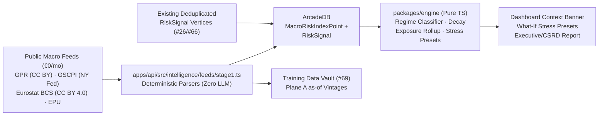

# Quantitative Risk Intelligence — News-Based Risk Indices & Supply-Chain Early Warning

> **Status:** Research & Feasibility Report (GitHub Issue [#82](https://github.com/Vanatoa23/Kulgo/issues/82))  
> **Date:** 2026-11-26  
> **Verdict:** **PILOT (Scoped Hybrid: External Macro Indicators + Event-Based Corridor Hazard)** · **POSTPONE** proprietary news-frequency indices · **REJECT** supplier-level news-frequency scoring  
> **Scope:** Evaluates whether adapting Caldara & Iacoviello (2022) news-based risk index methodology fits Kulgo's EU / Nordic-Baltic mid-market supply-chain platform without duplicating existing monitoring (`#26`, `#65`, `#66`) or financial risk (`#8`, `#38`) infrastructure.

---

## 1. Executive Summary & Recommendation

**Bottom-line recommendation:** **Do NOT build a proprietary GPR-style news-frequency risk index (`N_risk / N_total`) right now, and REJECT supplier-level news-frequency risk scoring.** Instead, **PILOT** a zero-data-cost, narrowly scoped **Hybrid Macro-Context & Event-Hazard Layer** (combining licensed public macro indicators with Kulgo's existing deduplicated Stage 1/Stage 2 `RiskSignal` stream) as a **context and scenario-stress overlay**—not an automatic probability multiplier—subject to strict chronological backtesting before touching customer EAL/VaR calculations.

### Why this is the right product decision for Kulgo
1. **Kulgo already has a superior event-centric pipeline:** Sub-Project 1 (`apps/api/src/intelligence/`) already runs a TypeScript-native **"Pull Once, Match Many"** pipeline with Stage 1 structured feeds (EU/OFAC sanctions, IMF PortWatch, GDACS, MeteoAlarm, ENTSO-E, Baltic official insolvency registers), Stage 2 UTF-8 multilingual LLM extraction with `articleId` + verbatim `evidenceQuote` provenance binding (`#65`, `#66`), syndication-aware corroboration, and a bounded sub-additive `liveRiskMultiplier` (`[0, 5]`) feeding `@kulgo/engine`'s EAL/VaR model (`packages/engine/src/financial-risk.ts`).
2. **A proprietary news-frequency index fails the denominator and unit-economics test:** Valid article-share indices require a fixed, consistently sampled full-news panel (including non-risk articles) with multi-year historical backfill. Kulgo's Stage 2 feeds are *risk-targeted* searches—dividing risk hits by risk-filtered outputs is mathematically invalid. Licensing a fixed commercial news archive (Factiva/LexisNexis or NewsAPI.ai/Event Registry + publisher text-mining rights) breaks Kulgo's €0–€35/mo MVP cost model and collides with `docs/PRIVACY_CONTRACT.md` copyright hygiene (`EXCERPT_ONLY`).
3. **Mid-market EU/Nordic-Baltic suppliers are news-sparse:** For 50–500 employee manufacturers in Estonia, Latvia, Lithuania, Finland, Sweden, and Poland, >95% of Tier-1/Tier-2 suppliers have zero national/international news mentions in a typical month. Supplier-level news indices collapse into `0/0` or extreme Poisson false spikes, and publishing automated news-derived supplier risk scores creates **reputational, defamation, and network-flywheel risk** (deterring suppliers from accepting partner invites or joining the Opt-In Directory).
4. **Empirical evidence favors structured physical/survey data + deduplicated events + sentiment-aware NLP over raw keyword counts:** Federal Reserve research (Soto, 2023) demonstrates that pure keyword frequency (`BBSCDI`) has no statistically significant predictive power for inflation once controlled, whereas sentiment-aware NLP (`SCB Sentiment`) and structured physical/survey indices (`GSCPI`) do. Meanwhile, unfiltered GDELT counts suffer severe false-positive rates (~79% non-protest URLs in Wang et al., 2016; 30.6% expert alignment in EMNLP 2024 `WORLDREP`).
5. **High-value, €0/mo public macro indicators exist with clean commercial rights:** Caldara & Iacoviello's **GPR** (`CC BY`), **EPU/GEPU** (`CC BY 4.0`), **European Commission / Eurostat Business & Consumer Surveys** (*shortage of material/equipment* across all 27 EU states including EE/LV/LT, `CC BY 4.0`), **NY Fed GSCPI** (public with non-endorsement notice), and **IMF PortWatch** (`CC BY 4.0`, already integrated) give Kulgo immediate, credible macro trend context and stress-test baselines at near-zero engineering cost.

---

## 2. Scientific Foundations & Empirical Evidence

### 2.1 Caldara & Iacoviello (2022) GPR Methodology Deconstructed
Caldara & Iacoviello (2022), *"Measuring Geopolitical Risk"* (*American Economic Review*, 112(4): 1194–1225), construct a monthly (and weekly-updated daily) text-based index of adverse geopolitical events:

- **Fixed Newspaper Panel:**
  - *Recent GPR (1985–present):* 10 Anglo-American newspapers (`Chicago Tribune`, `Daily Telegraph`, `Financial Times`, `The Globe and Mail`, `The Guardian`, `Los Angeles Times`, `The New York Times`, `USA Today`, `The Wall Street Journal`, `The Washington Post`).
  - *Historical GPRH (1900–present):* 3 newspapers (`Chicago Tribune`, `New York Times`, `Washington Post`).
- **8 Boolean Keyword Categories (Threats vs. Acts):**
  - **Geopolitical Threats (`GPRT`, Categories 1–5):** War Threats, Peace Threats, Military Buildups, Nuclear Threats, Terror Threats.
  - **Geopolitical Acts (`GPRA`, Categories 6–8):** Beginning of War, Escalation of War, Terror Acts.
- **Numerator, Denominator & Normalization:**
  - Monthly share $s_t = \frac{N_{\text{GPR},t}}{N_{\text{total},t}}$ across the fixed newspaper panel, where $N_{\text{total},t}$ is the total count of *all* published articles in those 10 newspapers in month $t$ (controlling for secular changes in newspaper length and digitization).
  - Normalized to a fixed historical mean of **100** over 1985–2019 (Recent) or 1900–2019 (Historical).
- **Geographic Attribution (44 Countries):**
  - Extended in Caldara, Conlisk, Iacoviello & Penn (2023) to **44 countries** by requiring an article to match both the GPR Boolean query *and* the country's name or major cities.
  - **Critical limitation for Kulgo:** The authors explicitly state that country-specific GPR *"captures the U.S. perspective on risks posed by, or involving, the country in question."* Coverage includes Finland, Sweden, Denmark, Norway, Poland, Germany, UK, Russia, and Ukraine, but **omits Estonia, Latvia, and Lithuania entirely**.
- **Validation & Revisions:** Validated against human-audited narratives, VAR macroeconomic responses (investment, employment, disaster risk), and firm-level investment regressions. Recent monthly/daily vintages are **preliminary and subject to retroactive revisions** due to delayed newspaper archive ingestion and duplicate removal.

### 2.2 Comparable Peer-Reviewed & Operational Indices
| Domain | Index / Paper | Method & Corpus | Empirical Finding & Relevance to Kulgo |
| :--- | :--- | :--- | :--- |
| **Global Supply Chains** | **NY Fed GSCPI** (Benigno et al., 2022, FRBNY Staff Report 1017) | PCA (Stock-Watson EM) on 27 variables: Baltic Dry Index, Harpex, BLS airfreight + demand-adjusted PMI delivery times, backlogs, stocks across 7 economies (CN, EA, JP, KR, TW, UK, US). | Strong explanatory power for US/Euro-area goods & PPI inflation. **Limitation:** Global aggregate only (no country/sector split), monthly lag (4th business day), retroactive PCA revisions. |
| **Supply Chain NLP** | **Fed SCB Sentiment** (Soto, 2023, FEDS Notes) vs. **BBSCDI** (Kliesen & Werner, 2022) | Word2Vec expansion of `"supply chain" + "bottlenecks"` + **FinBERT** sentence sentiment `(neg - pos) / total` on Fed Beige Books (8x/yr). | **Key negative finding for pure keyword counts:** Raw keyword frequency (`BBSCDI`) was statistically insignificant (`0.003`, SE `0.060`) in CPI regressions; sentiment-aware `SCB Sentiment` (`0.175**`) and `GSCPI` (`0.137*`) remained significant. Pure word counts fail when articles say *"bottlenecks are easing."* |
| **Maritime Physical Stress** | **World Bank GSCSI** (2024) & **IMF PortWatch** (Arslanalp et al., 2026) | AIS vessel tracking anomalies: waiting times, port calls, 7-day chokepoint transit volume drops across 28 chokepoints & 2,065 ports. | Measures **realized physical disruption** directly without media bias or syndication noise. PortWatch is already in Kulgo's Stage 1 stack (`LIVE_DISRUPTION_FEEDS_AND_ARCHITECTURE.md`). |
| **Policy & Trade Uncertainty** | **EPU / GEPU / TPU** (Baker, Bloom & Davis, 2016, *QJE*; Caldara et al., 2020) | Fixed national newspaper panels counting triple co-occurrence (`Economy + Policy + Uncertainty`), standardized per newspaper before averaging. | Strong macro investment/trade impact; `CC BY 4.0`. **Limitation:** National macro level; EU coverage includes DE, FR, IT, ES, NL, BE, IE, GR, PL, SE, DK, UK — **omits EE, LV, LT, FI, NO**. |
| **Broad Country Uncertainty** | **World Uncertainty Index (WUI)** (Ahir, Bloom & Furceri, 2022, NBER WP 29763) | Frequency of `"uncertain*"` in quarterly Economist Intelligence Unit (EIU) country reports across 143 countries. | Covers **Latvia and Lithuania** (and 140+ countries) with uniform corpus structure, but **quarterly frequency** is too slow for operational disruption early warning. |
| **EU Industrial Shortages** | **European Commission / Eurostat BCS** (*Factors limiting production*) | Harmonized monthly/quarterly survey of EU manufacturing managers reporting *shortage of material and/or equipment* and *economic uncertainty (EUI)*. | **Best EU/Nordic-Baltic structured indicator:** Covers all 27 EU member states (**incl. EE, LV, LT, FI, SE, PL, DE**) by NACE manufacturing sector under `CC BY 4.0`. |
| **Conflict & Event Big Data** | **GDELT 2.0** vs. **ACLED** vs. **WORLDREP** (EMNLP 2024) | Automated CAMEO event coding from global web news (GDELT) vs. human-curated conflict coding (ACLED). | Wang et al. (2016) and *Communication Methods & Measures* (2022) show **only 21% of GDELT protest URLs** reflect real protests; EMNLP 2024 `WORLDREP` found GDELT achieved **30.6% overall expert alignment** (48.8% conflict, 21.0% cooperation). Raw GDELT counts cannot be used as an index without heavy filtering/deduplication. |

### 2.3 Method Comparison: Predictive Power vs. Contemporaneous Detection
| Methodology | Contemporaneous Detection | Genuine Early Warning (Lead Time) | Noise / False Positives | Suitability for Kulgo |
| :--- | :--- | :--- | :--- | :--- |
| **1. Raw Keyword Counts** (GPR/EPU/BBSCDI style) | Moderate (macro only) | Low–Moderate for *threats* (tariffs, war buildups); poor for sudden shocks | High without fixed panel + sentiment/negation handling (Soto, 2023) | **Macro context only** (via external GPR/EPU), not proprietary build |
| **2. Supervised NLP / FinBERT** | High on domain-matched corpora | Moderate (detects tone deterioration in earnings/surveys) | Low–Moderate (requires labeled multilingual training data) | **Defer** until Training Data Vault (`#69`) accumulates labeled EU/Baltic data |
| **3. Embeddings / Topic Clustering** | High for clustering related reports | Low on its own | Moderate (topic drift across languages) | Useful for **deduplication/clustering**, not standalone risk scoring |
| **4. LLM Event Extraction** (Kulgo Stage 2) | **High** (extracts structured actors, chokepoints, lifecycle, `evidenceQuote`) | Moderate (captures `PLANNED` strikes, sanctions proposals, union ballots) | **Low** when paired with `#66` provenance binding + syndication-aware corroboration | **Already deployed** in `apps/api/src/intelligence/feeds/stage2.ts` |
| **5. Event-Based Hazard Models** (deduplicated incidents + survival/decay) | **High** | **Moderate–High** for cascading/prolonged disruptions (chokepoint congestion, strike escalation) | **Low** (immune to syndication inflation; tracks `CONFIRMED`/`CORROBORATED` counts) | **Best proprietary fit** — extends existing `RiskSignal` + `financial-risk.ts` |
| **6. External Structured Indicators** (PortWatch, Eurostat BCS, GSCPI, MeteoAlarm, Insolvency Registers) | **Very High** (physical/legal ground truth) | **High** (weather forecasts, AIS transit drops, manager shortage surveys, insolvency filings) | **Very Low** | **Highest ROI** — already Kulgo's Stage 1 backbone |

**Do indices add value over Kulgo's existing event alerts and risk scores?**
- **For immediate tactical alerts (days):** **No.** Deduplicated `RiskSignal` alerts + Stage 1 physical/legal feeds beat news-frequency indices on latency, precision, explainability, and actionable specificity.
- **For strategic/quarterly planning, board reporting, and financial stress-testing (months/quarters):** **Yes, modestly.** A macro/corridor regime indicator (e.g., *"Global Supply Chain Pressure is +1.8σ; EU Metals material shortage is at 85th percentile; Baltic/Eastern Border geopolitical tension is elevated"*) helps CFOs and procurement leads contextualize why EAL/VaR ranges widen, justify safety-stock investments, and run grounded What-If stress scenarios—**without** fabricating noisy supplier-level scores.

---

## 3. External Data vs. Proprietary News Indices vs. Event-Based Indicators

### 3.1 Commercial Data Rights, Licensing & Operational Assessment
*Note: Public web accessibility does NOT imply commercial-use or redistribution rights. Every source below was checked against primary terms/licenses as of November 2026.*

| Source / Approach | Frequency & History | EU / Nordic-Baltic Coverage | Revisions | Commercial Use & Redistribution Rights | Cost (MVP → Scale) | Operational Burden |
| :--- | :--- | :--- | :--- | :--- | :--- | :--- |
| **Option 1A: GPR Index** (`matteoiacoviello.com/gpr.htm`) | Monthly (1900/1985–) + Weekly-updated Daily (1985–) | 44 countries: FI, SE, DK, NO, PL, DE, UK, RU, UA. **No EE/LV/LT.** (US media lens) | Preliminary recent values revised retroactively | **Permitted (`CC BY`)** — commercial use, distribution & reproduction allowed with author/paper/URL attribution | **€0/mo** | Very low (1 static XLS/CSV fetch/wk) |
| **Option 1B: EPU / GEPU / TPU** (`policyuncertainty.com`) | Monthly (1985/1997–) | Global + 22+ countries incl. SE, DK, DE, FR, PL, UK. **No EE/LV/LT/FI/NO.** | Occasional archival/imputation revisions | **Permitted (`CC BY 4.0`)** — commercial use allowed with attribution | **€0/mo** | Very low (monthly CSV fetch) |
| **Option 1C: NY Fed GSCPI** (`newyorkfed.org/research/policy/gscpi`) | Monthly, 4th business day (1997–) | Global aggregate only (incl. Euro Area PMI component) | **Retroactive full-series revisions** every month (PCA re-fit) | **Permitted with mandatory disclaimer** under NY Fed Terms of Use (must carry non-endorsement notice & label any Kulgo modifications; underlying PMI/Harpex not redistributed raw) | **€0/mo** | Very low (monthly XLS/CSV fetch + vintage storage) |
| **Option 1D: Eurostat / EC BCS** (`economy-finance.ec.europa.eu`) | Monthly & Quarterly (1985/2000–) | **All 27 EU states incl. EE, LV, LT, FI, SE, PL, DE** + NACE sectors | Standard seasonal adjustment revisions | **Permitted (`CC BY 4.0`**, Commission Decision 2011/833/EU) | **€0/mo** | Low (SDMX/JSON API) |
| **Option 1E: IMF PortWatch** (`portwatch.imf.org`) | Daily / 7-day rolling (2019–) | 28 chokepoints & 2,065 ports incl. Baltic & North Sea | Weekly nowcast revisions; 1–3d AIS lag | **Permitted (`CC BY 4.0`)** with attribution (*Kpler; UN Global Platform; IMF PortWatch*) | **€0/mo** | Already in Kulgo Stage 1 |
| **Option 1F: ACLED** (`acleddata.com`) | Weekly (1997–) | Global incl. Europe | Ongoing retrospective coding | **RESTRICTED — Commercial license required** (EULA prohibits commercial SaaS redistribution without paid negotiated Commercial License Agreement) | **Undisclosed (Enterprise, €€€)** | Exclude from MVP |
| **Option 2: Proprietary News-Frequency Index** (Fixed panel via NewsAPI.ai / Event Registry, NewsData.io, Factiva, or GDELT) | Daily/Hourly; archive 2014+ (NewsAPI.ai) or 2015+ (GDELT) | Good in EN/DE/SE/FI; **sparse & noisy for EE/LV/LT** unless licensing local Baltic press | Source additions/dropouts cause severe **coverage drift** | **GDELT:** Unrestricted commercial use, *but* source articles remain publisher-copyrighted & noise is extreme. **NewsAPI.ai:** Commercial plans from ~$90/mo (5k tokens), historical backfill consumes 5 tokens/yr; **redistribution of article text restricted** (must remain `EXCERPT_ONLY`). **Factiva/LexisNexis:** Enterprise text-mining license (€15k–€50k+/yr). | **€90–€500+/mo** (API) or **€15k+/yr** (fixed press panel) + LLM/storage | **High** (panel maintenance, denominator tracking, drift QA) |
| **Option 3: Event-Based Hazard Index** (Kulgo deduplicated `RiskSignal` + Stage 1 feeds) | 3x daily (from deployment date; **no multi-year backfill yet**) | **Tailored to EU/Nordic-Baltic** (EE/LV/LT insolvency, MeteoAlarm, Digitraffic, ENTSO-E, multilingual Stage 2) | Immutable per `asOfDate` snapshot | **100% Kulgo-owned derivative** (Plane A public evidence; `EXCERPT_ONLY` copyright hygiene already enforced by `PRIVACY_CONTRACT.md`) | **€0 incremental** (reuses existing €0–€35/mo pipeline) | **Low** (extends existing `RiskSignal` & `@kulgo/engine`) |

---

## 4. Quantitative Methodology & Critique of Candidate Formulas

### 4.1 Critical Review of the Candidate Baseline Formulas
The issue proposes four candidate baseline formulas. Each has critical statistical failure modes that must be solved before any production use:

1. **Article Share: `R[e,k,t] = N_risk[e,k,t] / N_total[e,t]`**
   - **Failure Mode 1 — Invalid Denominator:** If `N_total[e,t]` comes from keyword-filtered search APIs or GDELT queries rather than a fixed, consistently sampled corpus, `R` measures *query composition*, not risk intensity.
   - **Failure Mode 2 — Source Panel Drift & Outages:** Adding a prolific RSS feed or losing a scraper mid-year shifts both numerator and denominator discontinuously. **Fix:** Caldara & Iacoviello / Baker-Bloom-Davis solve this with **source-level normalization** (standardize each source $s$ to unit variance over a fixed panel before averaging across active sources, and drop/flag windows where active panel coverage $< 70\%$).
   - **Failure Mode 3 — Syndication Inflation:** One Reuters/BNS wire story reprinted by 18 outlets inflates `N_risk` by 18x. Kulgo's `#66` `isLikelySyndicatedCopy()` in `apps/api/src/intelligence/dedupe.ts` already solves this at the *event* level—which is a strong argument for counting **deduplicated corroborated events**, not raw articles.
2. **Historical Normalization: `I[e,k,t] = 100 * R[e,k,t] / mean_baseline(R[e,k])`**
   - **Failure Mode 1 — Zero / Near-Zero Baselines:** For rare hazards (e.g., Baltic port strikes or sanctions on a specific EU country), `mean_baseline(R[e,k]) ≈ 0`, causing division-by-zero or absurd 10,000+ index spikes from a single event.
   - **Failure Mode 2 — Rolling vs. Fixed Baseline Leakage:** A fixed baseline (e.g., 1985–2019 for GPR) is stable and auditable, whereas a short rolling baseline (e.g., trailing 90 days) *normalizes away* prolonged crises (like the Red Sea crisis after 3 months). **Fix:** Use a **fixed multi-year reference period** (for external indices) or **robust percentile / z-score with floor** (MAD or Winsorized SD) rather than raw ratio-to-mean, and always tag `baselineVersion`.
   - **Failure Mode 3 — Small-Sample Noise:** When `N_total[e,t]` is small (e.g., a small country or niche sector), raw `R[e,k,t]` has huge binomial variance. **Fix:** Apply **Empirical Bayes / hierarchical shrinkage** toward the parent geography/sector rate:
     $$\hat{R}_{e,k,t} = \frac{N_{\text{risk}}[e,k,t] + \alpha_0 \cdot \mu_{\text{parent}(e),k,t}}{N_{\text{total}}[e,t] + \alpha_0}$$
     where $\alpha_0$ is the prior pseudo-count (effective sample size). Compute Wilson score or Beta-Binomial 95% confidence intervals; **abstain** when effective sample size falls below threshold.
3. **Weighted News Share: `R[e,k,t] = sum(relevance_i * severity_i * credibility_i) / N_total[e,t]`**
   - **Failure Mode — Confounding Ordinal LLM Scores with Calibrated Probabilities:** Multiplying three uncalibrated `[0,1]` heuristics (`relevance * severity * credibility`) produces an uninterpretable composite where a high-credibility minor advisory equals a low-credibility major catastrophe. LLM `confidence` scores in `stage2.ts` are **not** calibrated probabilities.
   - **Fix:** Keep dimensions **orthogonal**: (a) gate inclusion via discrete `verificationStatus` (`CONFIRMED` / `CORROBORATED` vs. `ALLEGED` excluded from active index); (b) map `severity` to discrete ordinal impact weights calibrated against historical TTR/EAL; (c) represent uncertainty separately via confidence intervals / badges (`HIGH`, `MODERATE`, `LOW`, `ABSTAIN`).
4. **Customer Exposure Aggregation: `KRI[c,t] = sum_j(weight[c,j] * I[j,t])`**
   - **Failure Mode 1 — Double-Counting Correlated Macro Shocks & Diamond Graph Paths:** If a customer has 4 suppliers in Germany or 2 Tier-1 suppliers sharing a hidden Tier-2 chokepoint (diamond topology), summing `weight * I[j,t]` across lanes double-counts the same underlying macro shock.
   - **Failure Mode 2 — Scale Mismatch:** Linearly weighting dimensionless indices (`100 = normal`) hides whether a supplier is substitutable (warm backup, 30-day safety stock) vs. a single-point-of-failure (SPOF) with a 90-day renewal cliff.
   - **Fix:** Separate the four risk layers strictly:
     1. **External Hazard Intensity ($H_{g,k,t}$):** Country/corridor/sector stress (external macro index or deduplicated event hazard).
     2. **Entity Exposure & Structural Vulnerability ($V_j$):** Already computed by `@kulgo/engine` (HHI, SPOF, TTS vs. TTR gap, renewal cliff, uncontracted spot gap).
     3. **Customer Commercial Dependency ($w_{c,j}$):** Contract-derived `activeSpendEur` or `activeVolume` share (`deriveNetworkCommercials()` in `packages/engine/src/contracts.ts`), **NOT** arbitrary static weights.
     4. **Financial Impact ($\text{EAL}, \text{VaR}$):** Computed via `computeEffectiveHorizonProb()` and common-shock deduplication (`eventGroupId`) in `packages/engine/src/financial-risk.ts`.

### 4.2 Candidate Specification for the Scoped Hybrid Pilot (Option 1 + Option 3)
If Kulgo pilots Quantitative Risk Intelligence, the pure mathematical engine (`@kulgo/engine`) should implement **two clean, deterministic, versioned constructs**:

1. **External Macro Regime Indicator ($M_{g,k,t}$)** *(from Option 1 public feeds)*:
   - Standardized as a **historical percentile rank** $P_{g,k,t} \in [0, 100]$ and **robust z-score** $z_{g,k,t} = \frac{x_{g,k,t} - \text{median}(x_{g,k})}{\max(\text{MAD}(x_{g,k}) \cdot 1.4826,\ \epsilon)}$ over a fixed reference window (e.g., 2000–2019 or full available pre-2020 history), mapped to 4 transparent regimes: `NORMAL` ($P < 75$), `ELEVATED` ($75 \le P < 90$), `HIGH` ($90 \le P < 97$), `EXTREME` ($P \ge 97$).
   - **Seasonality & Change-Points:** Use seasonally adjusted series where published (Eurostat BCS), and optionally flag structural shifts using a deterministic **CUSUM / EWMA change-point detector** over monthly deltas—pure TypeScript, zero ML runtime dependency.
2. **Event-Based Corridor/Country Hazard Intensity ($E_{g,k,t}$)** *(from Option 3 — Kulgo's existing deduplicated `RiskSignal`s)*:
   - Count **only** `CONFIRMED` and `CORROBORATED` canonical `RiskSignal` vertices (excluding `ALLEGED` and `RESOLVED`), weighted by discrete severity $s_i \in \{1.0\ (\text{YELLOW}),\ 2.5\ (\text{RED})\}$ with exponential temporal decay for recently resolved/aging signals:
     $$E_{g,k}(t) = \sum_{i \in \mathcal{S}_{g,k}} s_i \cdot \exp\left(-\frac{\ln 2}{\tau_k} \cdot \Delta t_i\right)$$
     where half-life $\tau_k$ is category-specific (e.g., 7 days for weather, 14 days for strikes/ports, 30 days for sanctions/geopolitical).
   - **No double-counting with `financial-risk.ts`:** Note that `deriveLiveRiskMultiplierFromSignals()` in `packages/engine/src/financial-risk.ts` already computes a bounded sub-additive multiplier $1 + \sqrt{\sum (\mu_i - 1)^2} \in [1, 5]$ for active `RiskSignal`s. Therefore, $E_{g,k}(t)$ should be used for **historical trend charts and early-warning anomaly detection**—never stacked multiplicatively on top of `deriveLiveRiskMultiplierFromSignals()` for the same events.

### 4.3 Entity-Level × Risk-Category Support Matrix & Abstention Rules
| Entity Level | Geopolitical / Sanctions | Supply Shortages | Logistics / Chokepoints | Financial Distress | Regulatory / Policy | Environmental / Weather |
| :--- | :--- | :--- | :--- | :--- | :--- | :--- |
| **Global** | **SUPPORTED** (GPR, `CC BY`) | **SUPPORTED** (NY Fed GSCPI) | **SUPPORTED** (GSCPI, PortWatch) | **ABSTAIN** (macro proxy only) | **SUPPORTED** (GEPU / TPU) | **SUPPORTED** (GDACS) |
| **Country (Major EU / Nordic)** | **SUPPORTED** (Country GPR: FI, SE, DK, NO, PL, DE, UK) | **SUPPORTED** (Eurostat BCS `CC BY 4.0`) | **SUPPORTED** (PortWatch country ports) | **PARTIAL** (National insolvency registers) | **SUPPORTED** (EPU / Eurostat EUI) | **SUPPORTED** (MeteoAlarm / GDACS) |
| **Country (Baltics: EE, LV, LT)** | **ABSTAIN on GPR** *(use EU/Regional + Stage 1/2 events)* | **SUPPORTED** (Eurostat BCS `CC BY 4.0`) | **SUPPORTED** (PortWatch + Digitraffic + Niord) | **SUPPORTED** (EE/LV/LT official registers) | **PARTIAL** (Eurostat EUI; WUI for LV/LT) | **SUPPORTED** (MeteoAlarm EE/LV/LT) |
| **Transport Corridor / Chokepoint** | **EVENT-ONLY** (Stage 1/2 `RiskSignal`) | **ABSTAIN** | **SUPPORTED** (IMF PortWatch 28 chokepoints + `chokepoints.ts`) | **ABSTAIN** | **EVENT-ONLY** | **EVENT-ONLY** (GDACS / NGA MSI) |
| **Sector (NACE)** | **ABSTAIN** | **SUPPORTED** (Eurostat BCS by NACE) | **ABSTAIN** | **ABSTAIN** | **PARTIAL** (Eurostat BCS) | **ABSTAIN** |
| **Commodity** | **ABSTAIN** | **DEFER** (requires commodity price feeds) | **ABSTAIN** | **ABSTAIN** | **ABSTAIN** | **ABSTAIN** |
| **Individual Company / SME Supplier** | **EVENT-ONLY** (EU/OFAC Sanctions exact match) | **ABSTAIN** | **ABSTAIN** | **EVENT-ONLY** (Official insolvency registry match) | **ABSTAIN** | **GEO-POLYGON ONLY** (Facility WKT) |

**Mandatory Abstention Rules (Hard Contract):**
1. **Never fabricate a country index** where the source omits the country (e.g., never silently substitute Russia or Sweden GPR for Estonia without an explicit `"Regional Proxy (Not Country-Specific)"` label—prefer returning `status: "INSUFFICIENT_DATA"`).
2. **Never compute a news-frequency index for an individual SME supplier.** Only emit verified, provenance-backed discrete events (sanctions hit, insolvency filing, facility-polygon weather alert, or corroborated news event with `evidenceQuote`).
3. **Abstain on thin panels:** If a future corpus-based index has $< 30$ total articles in the denominator window or $< 70\%$ active source panel uptime, return `status: "ABSTAIN"` with reason `LOW_SAMPLE_COVERAGE`.

---

## 5. Compatibility with Kulgo's Architecture, Privacy & Legal Guardrails

### 5.1 Direct Alignment with Existing Code & Issues
- **Pure `@kulgo/engine` (`docs/ARCHITECTURE.md`):** All index normalization, percentile/regime classification, decay curves, and customer exposure rollups are 100% pure TypeScript functions with zero I/O. External time-series snapshots and `asOfDate` are passed explicitly as inputs—matching the exact pattern of `fxRatesToEur` and `FINANCIAL_RISK_PARAMS_V1` in [`packages/engine/src/baselines.ts`](file:///home/antigravity/Vanatoa23/Kulgo/packages/engine/src/baselines.ts) and [`packages/engine/src/financial-risk.ts`](file:///home/antigravity/Vanatoa23/Kulgo/packages/engine/src/financial-risk.ts).
- **Zero Parallel Ingestion (`#26`, `#65`, `#66`, `#79`):** Monthly/weekly fetchers for GPR, GSCPI, EPU, and Eurostat BCS plug directly into `apps/api/src/intelligence/feeds/stage1.ts` as deterministic zero-LLM-token parsers, scheduled via `apps/api/src/intelligence/scheduler.ts` and persisted in ArcadeDB as `MacroRiskIndexPoint` vertices (or lightweight versioned snapshots). No Firecrawl/Python sidecars (`#79` verdict: SKIP) and no LangGraph/LangSmith (`#61`–`#64` verdict: SKIP).
- **Financial Exposure & Sanctions Separation (`#8`, `#38`):** Issue `#38` established that sanctions warnings must stay distinct and geographic risk matches must apply consistently. Macro indices must **not** overwrite or dilute discrete sanctions or active `RED` corridor alerts. In `financial-risk.ts`, macro indices should initially power **What-If Stress Presets** (e.g., *"Apply 90th-percentile GSCPI/GPR stress multiplier"*) rather than silently altering baseline `pBase` until empirically calibrated.
- **Tier-2+ Multi-Tier Privacy (`docs/PRIVACY_CONTRACT.md`):** Country/corridor macro stress can be propagated through verified `VERIFIED_PARTNER_LINK` edges strictly server-side in `apps/api/src/analytics/repository.ts` (reusing `MAX_TRAVERSAL_DEPTH = 4`, cycle-safe `visitedOrgIds`, and `fulfilledByFacilityId` scoping), emitting **only** an anonymized regional/tier macro stress summary—never exposing Tier-2+ supplier identities, countries (if sensitive), or coordinates. All new DTOs in `@kulgo/shared` must use `.strict()` and pass `pnpm test:privacy`.
- **Training Data Vault (`#69`, `docs/specs/TRAINING_DATA_VAULT.md`):** Archiving every external macro vintage (`asOfDate`, `vintageDate`, `rawValue`) alongside Plane A `RiskSignal`s in `.jsonl.gz` creates an **as-of point-in-time dataset** that prevents look-ahead leakage in future backtests.

### 5.2 Provenance, Security, Copyright & Supplier Legal/Reputational Risks
- **Auditability & Versioning:** Every displayed macro/hazard metric must carry `{ sourceId, sourceUrl, license, seriesId, periodDate, vintageDownloadedAt, modelVersion, regime, confidenceBadge, disclaimer }`.
- **Untrusted External Content & Prompt Injection:** External macro CSVs/JSONs are parsed deterministically with strict numeric/schema validation (zero LLM execution on macro feeds). Existing Stage 2 news feeds remain subject to `#66` `articleId` + verbatim `evidenceQuote` binding and `EXCERPT_ONLY` storage (`fullText: null`).
- **Supplier-Level Reputational, Defamation & Regulatory Risk (CRITICAL):**
  - Publishing an automated, opaque "Risk Score: 87/100" for a named private SME supplier based on scraped news articles exposes Kulgo to **commercial defamation / disparagement claims** under EU/Nordic tort law if an entity-resolution error or unverified rumor causes a buyer to terminate a contract.
  - Under the **EU AI Act** (Regulation (EU) 2024/1689, Annex III 5(b) & Art. 50 transparency duties), while B2B legal-entity supply-chain risk scoring is generally outside natural-person creditworthiness high-risk scope, **sole proprietorships / FIEs** (common in Estonia/Nordics) blur into natural persons, and transparency/explainability expectations are tightening across EU enterprise procurement.
  - **Commercial flywheel risk:** Kulgo's network moat depends on suppliers *accepting invitations* and joining the Opt-In Alternative Directory (`SUBPROJECT_5`). Suppliers will not join a platform that publishes unverified, black-box reputational scores about them.
  - **Design Rule:** Keep quantitative indices strictly at **Macro / Country / Sector / Corridor** granularity. At the **Supplier** level, show only verifiable, source-linked *facts* (official sanctions/insolvency filings, facility-polygon weather alerts, and user's own structural concentration/contract exposure).

---

## 6. Empirical Validation & Reproducible Pilot Plan

### 6.1 Current Data Blockers (Why We Cannot Execute a Full Proprietary Backtest Today)
1. **No multi-year historical Kulgo `RiskSignal` archive yet:** Sub-Project 1 and the Training Data Vault (`#69`) are newly built; there is not yet 12–24 months of longitudinal Plane A sweeps or Plane B user dismissal outcomes.
2. **No licensed historical fixed-panel Baltic/EU news archive:** Without a paid archive (Factiva / NewsAPI.ai backfill), a proprietary news-frequency index cannot be backtested honestly without look-ahead bias or GDELT coverage-drift artifacts.

### 6.2 Concrete, Reproducible Retrospective Pilot Design (Runnable in 1–2 Weeks)
Before committing any engineering effort beyond a macro-context card, run an offline, reproducible backtest in `scripts/eval/risk-index-pilot/` using **publicly available historical datasets**:

- **Ground-Truth Disruption Benchmark (Independently Documented Events, 2019–2025):**
  1. **Maritime/Corridor Shocks:** Suez Canal blockage (Mar 2021), Shanghai port lockdown (Apr–May 2022), Red Sea / Bab el-Mandeb rerouting (Dec 2023–2024), Panama Canal drought restrictions (2023–2024), Finnish/Baltic port & stevedore strikes (Mar 2024). Ground truth: **IMF PortWatch** >25% 7-day transit drops + official port authority notices.
  2. **EU Industrial Supply Shortages:** 2021–2022 semiconductor/metals shortages and 2022–2023 EU energy/chemical shocks. Ground truth: **Eurostat BCS** material-shortage spikes (>90th percentile) and industrial production drops.
  3. **Geopolitical/Sanctions Shocks:** Feb 2022 Russia-Ukraine invasion & EU sanctions packages 1–14 affecting EU–Eastern Border corridors.
- **Four Competing Models Compared:**
  - `M0 (Baseline):` Existing alert-based / simple keyword rule (Stage 1 structured alerts + Stage 2 keyword filter).
  - `M1 (External Macro):` Historical vintages of **GPR** (daily/monthly, using published vintage files `data_gpr_export_YYYYMM.xls` to prevent revision leakage!) + **NY Fed GSCPI** + **Eurostat BCS**.
  - `M2 (Normalized News Index):` Fixed-domain GDELT subset normalized by total domain volume (`N_risk / N_total`) with Empirical Bayes shrinkage.
  - `M3 (Deduplicated Event-Based Hybrid):` `M1` macro regime + decayed count of deduplicated, corroborated events (with syndication filtering).
- **Evaluation Protocol & Anti-Leakage Controls:**
  - **Strict Chronological Split:** Train/calibrate thresholds on 2019–2022; evaluate strictly out-of-sample on **2023–2025** using **as-of vintage data** (no future PCA/baseline normalization).
  - **Separate Contemporaneous Detection from Prediction:** Measure both $t=0$ detection delay (days) and $t+7\text{d} / t+30\text{d}$ actionable lead time prior to >25% PortWatch transit drop or >1σ shortage surge.
  - **Metrics:** Precision, Recall, False Alert Rate per entity-year, Median Actionable Lead Time (days), **Brier Score & Calibration Reliability Curve** (only if mapping to disruption probabilities), and **Incremental Decision Value** (simulated safety-stock/expediting EAL savings in `@kulgo/engine` vs. false-alarm carrying cost).
  - **Sensitivity & Stress Tests:** Drop 30% of news sources (outage test), inject 10x syndicated duplicates, test EN-only vs. multilingual (EE/FI/DE/PL) coverage, and test low-volume entities (Estonia/Latvia vs. Germany).
- **Explicit Go / No-Go Criteria (Pass All to Advance):**
  - `M3` (or `M1`) must reduce false-positive regime alerts by **≥ 30%** vs. `M2` (raw news index) *and* provide **≥ 5 days** actionable lead time or statistically significant EAL stress-range improvement on ≥ 60% of benchmark disruptions.
  - If `M1` alone captures >85% of the incremental value of `M3` at 10% of the complexity, **do not build `M2` or complex event indices**.

---

## 7. MVP Architecture, Customer Use Cases & Cost Analysis

### 7.1 Scoped MVP Architecture (Pilot — Option 1 + Lightweight Option 3)

- **Customer-Facing Use Cases (Zero New Clutter):**
  1. **Macro Risk Context Strip (Dashboard):** Shows current regime (`NORMAL / ELEVATED / HIGH / EXTREME`) for *Global Supply Chain Pressure (GSCPI)*, *EU Material Shortages (Eurostat BCS)*, and *Corridor/Country Geopolitical Tension (GPR)* with source links, `asOfDate`, and explicit abstention badges where a country is uncovered.
  2. **Grounded What-If Stress Presets (`WhatIfSimulatorDrawer`):** 1-click *"Stress-test against current Elevated Macro Regime"* or *"Replay 2022 Supply Shock"* using historical percentile multipliers rather than arbitrary user guesses.
  3. **Board / Executive Report Context:** Adds a concise, cited macro backdrop section explaining external headwinds alongside the customer's structural HHI, SPOF, and EAL/VaR ranges.

### 7.2 Cost & Complexity Comparison (MVP / Growth / Scale)
| Approach | Acquisition / Backfill Cost | Monthly Ongoing Cost (10 / 100 / 1,000 Orgs) | Engineering Complexity | Commercial Rights Risk |
| :--- | :--- | :--- | :--- | :--- |
| **Status Quo** (Existing `#26` alerts + `#8` financial risk) | €0 | €0 / ~€35 / ~€110 | Baseline (already built) | Very Low |
| **Option 1: External Macro Indicators** (GPR + GSCPI + Eurostat BCS + EPU) | **€0** (1985–2026 history included) | **€0 / €0 / €0** incremental | **Low** (~1–2 weeks: 4 deterministic parsers + pure engine helpers + UI strip) | **Very Low** (`CC BY` / `CC BY 4.0` + NY Fed disclaimer) |
| **Option 2: Proprietary News-Frequency Index** (Fixed panel + backfill) | **€500–€2,000** (API backfill) or **€15k–€50k/yr** (Factiva/press panel) | **€120–€600+ / mo** (API + LLM + storage + drift QA) | **High** (6–10 weeks + permanent corpus maintenance) | **High** (EU DSM copyright, scraping/redistribution limits, supplier defamation) |
| **Option 3: Event-Based Hazard Index** (from existing `RiskSignal` + PortWatch) | €0 *(no multi-year backfill; builds organically)* | **€0** incremental | **Low–Medium** (~1–2 weeks in `@kulgo/engine` + ArcadeDB query) | **Very Low** (100% Kulgo-owned Plane A derivatives) |
| **Recommended Hybrid Pilot** (Option 1 + Option 3 context/stress layer) | **€0** | **€0** incremental | **Low** (~2–3 weeks total across 3 small PRs) | **Very Low** |

---

## 8. Decision Matrix & Sequenced Roadmap

### 8.1 Decision Matrix
| Criterion (Weight) | Option 1: External Macro | Option 2: Proprietary News Index | Option 3: Event-Based Hazard | **Hybrid Pilot (1 + 3)** |
| :--- | :---: | :---: | :---: | :---: |
| **Empirical Signal & Predictive Validity (25%)** | 4/5 (macro/survey proven) | 2/5 (noisy without Factiva; fails for SMEs) | 4/5 (immune to syndication; physical ground truth) | **4.5/5** |
| **EU / Nordic-Baltic Coverage (20%)** | 3.5/5 (Eurostat strong; GPR misses Baltics) | 2/5 (EN bias; Baltic SME sparsity) | 4.5/5 (Baltic registries + MeteoAlarm + Digitraffic) | **4.5/5** |
| **Commercial Rights & Legal Safety (20%)** | 5/5 (`CC BY` / public) | 1.5/5 (copyright + defamation risk) | 5/5 (Kulgo-owned + `EXCERPT_ONLY`) | **5/5** |
| **Unit Economics & Maintenance (20%)** | 5/5 (€0/mo) | 1.5/5 (€120–€500+/mo + drift) | 4.5/5 (€0 incremental) | **4.5/5** |
| **Fit with Kulgo Architecture (15%)** | 5/5 (Stage 1 + pure engine) | 2/5 (needs parallel corpus infra) | 5/5 (extends `RiskSignal` + `financial-risk.ts`) | **5/5** |
| **Weighted Score** | **4.43 / 5** | **1.80 / 5** | **4.55 / 5** | **4.68 / 5** |
| **Decision** | **ADOPT IN PILOT** | **POSTPONE / REJECT** | **ADOPT IN PILOT** | **PILOT** |

### 8.2 Opportunity Cost & Go/No-Go Sequencing
- **Opportunity Cost:** Kulgo's highest near-term customer value still comes from completing/polishing Phase 2 core workflows (Contracts/EAL adoption, CSRD reporting, Supplier Onboarding & Registry enrichment `#29`, and keeping live alerts crisp and noise-free). Spending 6–10 weeks building a proprietary news-frequency index would directly delay revenue-generating customer features for an unproven signal.
- **Proposed Sequencing & Gates:**
  1. **Gate 1 (Now — 1 week, offline):** Run the reproducible retrospective pilot script comparing `M0–M3` on 2019–2025 public vintages (PortWatch, GPR, GSCPI, Eurostat BCS) to verify signal value and calibrate regime thresholds.
  2. **Gate 2 (Pilot MVP — 2 weeks, only if Gate 1 passes):** Ship deterministic Stage 1 ingestors for **Eurostat BCS**, **GPR**, and **NY Fed GSCPI** (with mandatory attribution/disclaimers and strict abstention for uncovered countries) + pure `@kulgo/engine` regime & event-hazard trend helpers surfaced strictly as **Dashboard Macro Context** and **What-If Stress Presets** (not silently mutating EAL).
  3. **Gate 3 (Re-evaluate in 12–18 months):** Once the Training Data Vault (`#69`) holds 12+ months of clean Plane A multilingual sweeps and Plane B dismissal outcomes, re-evaluate whether fine-tuned multilingual sentiment/hazard models add measurable out-of-sample lift over Gate 2.

---

## 9. Proposed Narrowly Scoped Follow-Up Issues (Do Not Implement Under #82)

If you decide to proceed with the **PILOT**, split execution into three small, independently verifiable issues:

1. **Follow-Up Issue A — `[Eval] Retrospective Pilot: External Macro Indicators vs. Event-Based Corridor Hazard (2019–2025)`**
   - Build a reproducible offline script using historical GPR vintages, NY Fed GSCPI, Eurostat BCS, and IMF PortWatch disruptions with strict chronological splits (2019–2022 train / 2023–2025 test) and report precision/recall, lead time, and EAL decision value.
2. **Follow-Up Issue B — `feat(intelligence): Deterministic Stage 1 Macro Index Ingestors (Eurostat BCS, GPR, NY Fed GSCPI)`**
   - Add zero-LLM monthly/weekly parsers in `apps/api/src/intelligence/feeds/stage1.ts`, `MacroRiskIndexPoint` persistence in ArcadeDB with `asOfDate` / `vintageDownloadedAt` / `license` / `disclaimer`, and Plane A Training Vault archival. Enforce explicit `ABSTAIN` for uncovered Baltic countries on GPR.
3. **Follow-Up Issue C — `feat(engine,web): Pure Macro Regime & Corridor Hazard Context Overlay + What-If Stress Presets`**
   - Add pure TypeScript percentile/regime classification and decayed event-hazard trend helpers in `packages/engine/`, `.strict()` DTOs in `packages/shared/` (verified by `pnpm test:privacy`), and a read-only Macro Context strip + What-If stress presets in `apps/web/`.

---

## 10. Primary Sources & References

1. **Caldara, D. & Iacoviello, M. (2022).** *Measuring Geopolitical Risk.* American Economic Review, 112(4), 1194–1225. Dataset, methodology & `CC BY` license: https://www.matteoiacoviello.com/gpr.htm and https://www.matteoiacoviello.com/gpr_country.htm
2. **Caldara, D., Conlisk, S., Iacoviello, M., & Penn, M. (2023).** *Do Geopolitical Risks Raise or Lower Inflation?* (44-country GPR extension).
3. **Benigno, G., di Giovanni, J., Groen, J. J. J., & Noble, A. I. (2022).** *The GSCPI: A New Barometer of Global Supply Chain Pressures.* Federal Reserve Bank of New York Staff Report No. 1017. Portal & release schedule: https://www.newyorkfed.org/research/policy/gscpi
4. **Soto, P. E. (2023).** *Measurement and Effects of Supply Chain Bottlenecks Using Natural Language Processing.* FEDS Notes, Board of Governors of the Federal Reserve System, February 6, 2023. https://www.federalreserve.gov/econres/notes/feds-notes/measurement-and-effects-of-supply-chain-bottlenecks-using-natural-language-processing-20230206.html
5. **Kliesen, K. L. & Werner, D. (2022).** *Using Beige Book Text Analysis to Measure Supply Chain Disruptions.* Federal Reserve Bank of St. Louis Economic Synopses, No. 18.
6. **Baker, S. R., Bloom, N., & Davis, S. J. (2016).** *Measuring Economic Policy Uncertainty.* Quarterly Journal of Economics, 131(4), 1593–1636. Data & `CC BY 4.0` license: https://www.policyuncertainty.com/global_monthly.html
7. **Ahir, H., Bloom, N., & Furceri, D. (2022).** *The World Uncertainty Index.* NBER Working Paper 29763. https://worlduncertaintyindex.com/
8. **European Commission (DG ECFIN) / Eurostat.** *European Business Cycle Indicators & Harmonised EU Business and Consumer Surveys (BCS)* (`CC BY 4.0`, Commission Decision 2011/833/EU).
9. **IMF & University of Oxford.** *IMF PortWatch* (`CC BY 4.0` with Kpler/UNGP/IMF attribution) & Arslanalp et al. (2026), *Nowcasting Country-Level Trade Estimates Using IMF PortWatch*. https://portwatch.imf.org/
10. **World Bank (2024).** *Global Supply Chain Stress Index (GSCSI): A Metric of Global Maritime Supply Chain Disruptions.*
11. **Wang, W., Kennedy, R., Lazer, D., & Ramakrishnan, N. (2016)** & *Lifting the Veil on the Use of Big Data News Repositories* (*Communication Methods and Measures*, 2022): https://www.tandfonline.com/doi/full/10.1080/19312458.2022.2128099
12. **EMNLP Findings (2024).** *A Reliable Dataset for Text-Based Event Modeling (WORLDREP)* (benchmarking GDELT 30.6% expert alignment): https://aclanthology.org/2024.findings-emnlp.526.pdf
13. **GDELT Project Terms of Use:** https://gdeltproject.org/about.html ; **ACLED EULA / Commercial License Terms:** https://acleddata.com/eula
14. **Kulgo Internal References:** [`docs/ARCHITECTURE.md`](../ARCHITECTURE.md), [`docs/PRIVACY_CONTRACT.md`](../PRIVACY_CONTRACT.md), [`docs/ROADMAP.md`](../ROADMAP.md), [`docs/research/LIVE_DISRUPTION_FEEDS_AND_ARCHITECTURE.md`](./LIVE_DISRUPTION_FEEDS_AND_ARCHITECTURE.md), [`docs/research/AI_ORCHESTRATION_AND_KNOWLEDGE_SYNTHESIS.md`](./AI_ORCHESTRATION_AND_KNOWLEDGE_SYNTHESIS.md), [`packages/engine/src/financial-risk.ts`](../../packages/engine/src/financial-risk.ts), [`packages/engine/src/baselines.ts`](../../packages/engine/src/baselines.ts), [`apps/api/src/intelligence/feeds/stage2.ts`](../../apps/api/src/intelligence/feeds/stage2.ts), [`apps/api/src/intelligence/dedupe.ts`](../../apps/api/src/intelligence/dedupe.ts).
